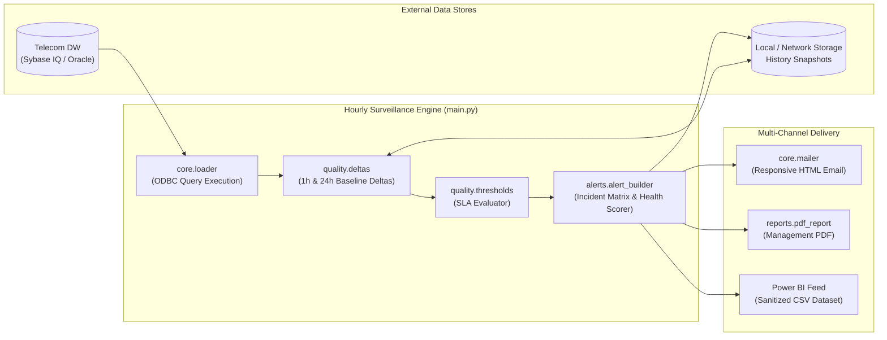

# System Architecture & Technical Specification

## Overview

The **Hourly KPI Surveillance Platform** operates as an automated, modular batch processing pipeline executing on an hourly cadence. This document outlines the component architecture, data pipeline execution sequence, error containment boundaries, and schema lifecycle.

---

## 1. High-Level Component Architecture



---

## 2. Pipeline Execution Sequence

Each hourly execution undergoes a deterministic, 8-phase lifecycle:

1. **Environment & Secret Initialization (`core.env_loader`):**
   - Reads `.env` for database connection credentials (`DB_DSN`, `DB_USERNAME`, `DB_PASSWORD`) and SMTP email configuration. Real system environment variables take precedence over `.env`.

2. **Configuration Validation:**
   - Loads `config/config.json` and `config/thresholds.json`. Validates directory paths (`./output`, `./output/history`, `./sql`).

3. **Telemetry Ingestion (`core.loader`, `core.db`):**
   - Connects to the data warehouse via `pyodbc` with a 10-second timeout guard.
   - Executes `sql/hourly_raw_counters.sql` using inline `FROM`-clause subqueries, extracting raw counters and computing baseline formulas for all MSC nodes.

4. **Datehour Normalization & Key Hygiene:**
   - Combines `day` and `hour` telemetry into a standardized Python `datetime` timestamp (`datehour`).
   - Normalizes and strips node identifiers (`node`).

5. **Vectorized Delta & Rolling Baseline Processing (`quality.deltas`):**
   - **1-Hour Delta:** Joins against the immediately preceding hourly snapshot to compute absolute difference (`_change`) and percentage difference (`_change_pct`).
   - **24-Hour Rolling Baseline:** Averages historical snapshots for the identical hour-of-day over the lookback window, calculating rolling deviation percentages (`_rolling7_dev_pct`).

6. **Multi-Tier SLA Classification (`quality.thresholds`):**
   - Compares raw KPI values against `warning_min` and `critical_min`.
   - Checks relative delta drops (`warning_change_pct`, `critical_change_pct`) to escalate declining trends to Warning or Critical even if absolute values have not yet breached static floors.

7. **Stateful 48-Hour Incident Correlation (`alerts.alert_builder`):**
   - Melts status columns into a normalized format.
   - Computes the **Network Health Score** (weighted by Erlang load and VLR subscriber density).
   - Generates change reports classifying nodes into `NEW CRITICAL`, `PERSISTENT`, and `RECOVERED`.

8. **Multi-Channel Dispatch:**
   - Exports sanitized CSV with deduplicated headers for Power BI.
   - Compiles and transmits multi-part MIME executive HTML emails.
   - Compiles management PDF report with landscape visual tables.

---

## 3. Data Resilience & Defensive Coding Standards

### Defensive Type Coercion
Telecom telemetry frequently encounters network outages resulting in `NULL`, empty strings, or division-by-zero errors. All mathematical computations enforce strict numeric safety:
```python
def _safe_numeric(series: pd.Series) -> pd.Series:
    return pd.to_numeric(series, errors="coerce")
```

### Power BI Schema Sanitization
Power BI and data lakehouses fail when CSV columns contain duplicate names, unexpected line breaks, or literal `"nan"` strings. The export module enforces:
1. Stripping `\r`, `\n`, `\t` and replacing spaces with underscores.
2. Deduplication using deterministic numeric suffixing (`_1`, `_2`).
3. Explicit preservation of missing values as true empty CSV fields (`""`) rather than string literals.

---

## 4. Security & Isolation

- **Zero Hardcoded Secrets:** Passwords and tokens are strictly excluded from code and config templates.
- **Git Ignore Safeguards:** `.gitignore` explicitly prevents accidental commits of `.env`, `config.json`, logs, outputs, and multi-megabyte parquet/CSV telemetry extracts.
