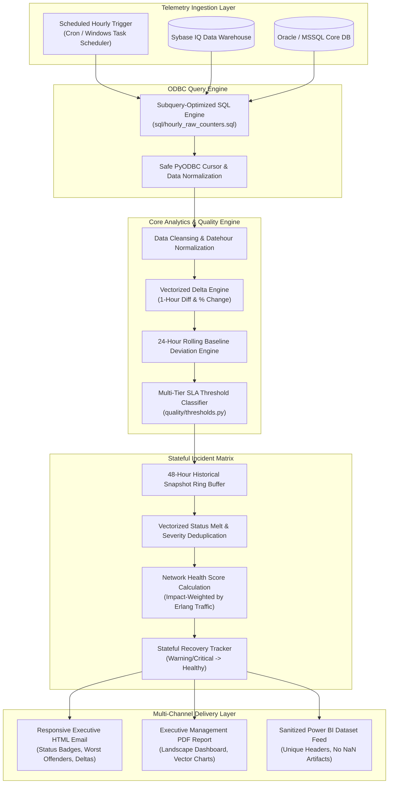

# Telecom Core Hourly KPI Surveillance & Incident Response Platform

[](https://www.python.org/)
[](https://pandas.pydata.org/)
[](https://github.com/)
[](LICENSE)
[](ARCHITECTURE.md)
[](https://github.com/)

> **A mission-critical data engineering and automated incident response engine for 24/7 telecommunications core network surveillance (MSC, VLR, SGSN, and RAN).**  
> Evaluates 11 core 3GPP KPI suites across hourly snapshots, computes vectorized deltas against 24-hour baselines, tracks stateful 48-hour incident lifecycles, and dispatches responsive executive HTML emails, C-level PDF briefs, and clean Power BI feeds.

---

## Executive Summary & Engineering Highlights

In cellular telecommunications networks, undetected degradations in call setup, location updates, or paging can result in tens of thousands of dropped calls, stranded subscribers, and SLA penalties within minutes. 

This platform replaces legacy, manual NOC monitoring with an automated, production-grade surveillance pipeline:
- **High-Throughput Vectorized ETL**: Processes multi-gigabyte network telemetry counter extracts using vectorized Pandas and NumPy operations, avoiding iterative bottlenecks.
- **Dynamic Multi-Tier SLA Classification**: Evaluates absolute thresholds (OK, Warning, Critical) and relative delta trends against both 1-hour prior snapshots and 7-day/24-hour rolling baselines.
- **Stateful 48-Hour Incident Lifecycle**: Correlates ongoing network anomalies across a 48-hour sliding window, tracking worsening degradations and auto-detecting node recoveries to eliminate NOC alert fatigue.
- **Enterprise Multi-Channel Dispatch**: Automatically delivers rich, responsive HTML emails with executive health scores, C-level PDF management reports (ReportLab), and sanitized datasets for Power BI dashboards.
- **Production Resilience**: Purpose-built to bypass enterprise ODBC truncation anomalies (e.g. Sybase IQ CTE driver limitations) and handle malformed telemetry data without process termination.
- **Zero-Trust Security**: Complete separation of secrets using environment variables (`.env`) with zero hardcoded credentials or database passwords.

---

## System Architecture



---

## 3GPP Monitored Telecommunication Domains

The platform monitors **11 critical telecom core network suites** complying with standard 3GPP formulas:

| Domain | Key Metrics Monitored | 3GPP Standard Objective | Alert Triggers |
|---|---|---|---|
| **Call Setup (CSSR)** | `cssr`, `cssr_gsm`, `cssr_wcdma`, `call_sr` | End-to-end call establishment success rate | Absolute < 98.0% or Delta Drop > 7% |
| **Channel Assignment (CASSR)** | `mo_channel_assignment_sr`, `channel_assignment_sr_gsm` | Dedicated channel allocation success | Absolute < 98.5% or Delta Drop > 5% |
| **Location Update (LUSR)** | `overall_lusr`, `registered_subscribers_lusr`, `non_registered_subscribers_lusr`, `periodic_update_lusr` | Subscriber roaming and mobility management | Absolute < 90.0% or 24h baseline drop |
| **Paging Performance** | `system_perceived_paging_success`, `first_paging_sr`, `second_paging_sr` | Core-to-RAN mobile termination reachability | Absolute < 75.0% or Second attempt spike |
| **Traffic & Capacity** | `erlang_traffic`, `vlr_subscribers` | Voice traffic load and attached subscriber count | Sudden anomaly vs historical capacity |
| **Mobility & Handovers** | `inter_msc_handover_success_gsm`, `intra_cell_handover_sr` | Seamless session transfer across cell boundaries | Absolute < 97.0% |
| **Security & Ciphering** | `ciphering_sr_gsm`, `ciphering_sr_wcdma` | Encryption establishment across GSM and UMTS | Absolute < 99.0% |
| **Subscriber Authentication** | `authentication_sr` | HLR/AUC authentication challenge success | Absolute < 97.5% |
| **Device Validation** | `imei_fetch_ms_sr` | Equipment identity validation with EIR | Absolute < 90.0% |
| **Messaging Services** | `originating_sms_sr`, `terminating_sms_sr` | SMS delivery over signaling channels | Absolute < 98.0% |
| **Circuit-Switched Fallback** | `csfb_sgs_success`, `csfb_sgs_success_network_performance` | 4G LTE to 2G/3G CSFB transition reliability | Absolute < 95.0% |

---

## Repository Layout

```
Hourly_KPI_Platform/
├── alerts/
│   ├── __init__.py
│   └── alert_builder.py       # Vectorized alert melt, incident tracking & HTML builder
├── config/
│   ├── config.example.json    # Sanitized configuration template
│   └── thresholds.json        # SLA thresholds & percentage drop rules for 30+ KPIs
├── core/
│   ├── __init__.py
│   ├── db.py                  # PyODBC connection pool with timeout protection
│   ├── env_loader.py          # Secure environment variable loader (.env fallback)
│   ├── history.py             # Snapshot persistence & 48h sliding-window loader
│   ├── loader.py              # SQL query executor with auto-detection
│   ├── logger.py              # Structured application logger with logfile rotation
│   └── mailer.py              # Multi-part MIME SMTP mailer with TLS & attachment support
├── kpi/                       # Modular KPI calculation routines
├── quality/
│   ├── __init__.py
│   ├── deltas.py              # Vectorized 1h delta & 24h rolling deviation engine
│   └── thresholds.py          # Dynamic multi-tier SLA classifier
├── reports/
│   ├── __init__.py
│   └── pdf_report.py          # ReportLab executive dashboard PDF generator
├── sql/
│   ├── hourly_raw_counters.sql # High-performance Sybase IQ / Oracle aggregation query
│   └── Old/                   # Reference legacy domain-specific SQL scripts
├── .env.example               # Template for environment credentials
├── .gitignore                 # Enterprise ignore rules for Python, logs, data dumps
├── ARCHITECTURE.md            # Detailed system design & failure recovery specification
├── CONTRIBUTING.md            # Open-source and team contribution guidelines
├── demo_pipeline.py           # Standalone offline runner (Zero database required)
├── LICENSE                    # MIT License
├── main.py                    # Production entrypoint & hourly scheduler coordinator
├── PORTFOLIO.md               # Senior Engineering Case Study & Technical Narrative
└── requirements.txt           # Project dependencies
```

---

## Quickstart & Interactive Demo

You can test-drive the entire surveillance engine immediately on any machine without access to a live telecom database.

### 1. Clone & Set Up Virtual Environment

```bash
git clone https://github.com/your-username/Hourly_KPI_Platform.git
cd Hourly_KPI_Platform

# Create virtual environment
python -m venv .venv

# Activate environment
# On Windows:
.venv\Scripts\activate
# On Linux/macOS:
source .venv/bin/activate

# Install dependencies
pip install -r requirements.txt
```

### 2. Run the Offline Demo Pipeline

```bash
python demo_pipeline.py
```

**What the demo does in ~3 seconds:**
1. Generates synthetic hourly telemetry snapshots for 6 core MSC nodes (`MSC-NORTH-01`, `MSC-SOUTH-01`, etc.).
2. Simulates realistic historical baseline snapshots with multi-hour degrading scenarios.
3. Computes 1-hour deltas and 24-hour baseline deviations.
4. Classifies KPI statuses (`OK`, `WARNING`, `CRITICAL`).
5. Generates the **Network Health Score** and 48-hour incident matrix.
6. Produces:
   - **Interactive HTML Email Preview**: `output/demo_alert_email.html` (open in any web browser)
   - **Executive PDF Report**: `output/reports/demo_Hourly_KPI_Report_*.pdf`
   - **Sanitized Power BI Dataset**: `output/demo_KPI_MSC_HOURLY.csv`

---

## Production Setup & Deployment

### 1. Configure Environment Secrets

Copy `.env.example` to `.env` and fill in your database and SMTP credentials:

```bash
cp .env.example .env
```

Edit `.env`:
```ini
DB_DSN=TELECOM_CORE_PROD_DSN
DB_USERNAME=kpi_analytics_user
DB_PASSWORD=your_secure_db_password

SMTP_SERVER=mail.telecom.internal
SMTP_PORT=25
SMTP_USE_TLS=false
EMAIL_SENDER=kpi-surveillance@telecom.com
EMAIL_RECIPIENTS=core-noc@telecom.com,rf-performance@telecom.com
```

### 2. Configure Thresholds (`config/thresholds.json`)

Customize critical and warning thresholds to match your network SLA targets:
```json
"cssr": { 
  "warning_min": 98.5, 
  "critical_min": 98.0, 
  "warning_change_pct": -3.0, 
  "critical_change_pct": -7.0, 
  "rolling_warn_dev_pct": -5.0, 
  "rolling_crit_dev_pct": -8.0 
}
```

### 3. Run Live Hourly Execution

```bash
python main.py
```

### 4. Automated Scheduling

- **Linux (Cron)**:
  ```bash
  0 * * * * cd /opt/Hourly_KPI_Platform && /opt/Hourly_KPI_Platform/.venv/bin/python main.py >> logs/cron.log 2>&1
  ```
- **Windows (Task Scheduler)**:
  Configure an Hourly Task triggering `python.exe main.py` in the project working directory.

---

## Technical Problem Solving & Gotchas Handled

| Challenge | Root Cause | Engineering Solution |
|---|---|---|
| **Sybase IQ ODBC Truncation** | When multiple Common Table Expressions (CTEs) were joined, the Sybase IQ 16 ODBC driver silently truncated query output from ~8,700 rows down to ~930 rows. | Re-architected `sql/hourly_raw_counters.sql` with inline `FROM`-clause subqueries, achieving 100% data extraction fidelity. |
| **Cartesian Join Memory Spikes** | Traditional alerting scripts loop over row items or join wide tables repeatedly, leading to exponential memory consumption. | Designed a vectorized Pandas `.melt()` strategy on numeric `_status` columns, performing index lookups in $O(N)$ time. |
| **Alert Fatigue in NOC** | Sending repeated alerts for continuous low-grade issues overwhelms engineers. | Implemented a 48-hour stateful history matrix that tracks persistent anomalies and explicitly highlights *newly degraded* vs *recovering* nodes. |
| **Power BI Column Collisions** | Pre-existing numeric column suffixes (e.g. `_1`) collided during multi-table merges, creating invalid duplicate headers. | Created `make_unique_columns()` and `export_csv_for_powerbi()` to sanitize all whitespace and ensure deterministic column uniqueness. |

---

## Portfolio & Author

Developed by **Kamiran Gabriel**  
*Senior Telecom Data & Performance Engineer*

- **Domain Expertise**: Core Network Performance (2G/3G/4G/5G), Cellular Telephony Protocols (3GPP), Automated NOC Monitoring.
- **Data Engineering**: Python, Pandas, NumPy, SQL, PyODBC, Relational Data Warehouses (Sybase IQ, Oracle, MSSQL), Power BI integration.
- **Software Architecture**: Resilient ETL, Failure Containment, Vectorized Analytics, Automated PDF & HTML Reporting.

*For detailed architectural specifications and design narratives, see [PORTFOLIO.md](PORTFOLIO.md) and [ARCHITECTURE.md](ARCHITECTURE.md).*
